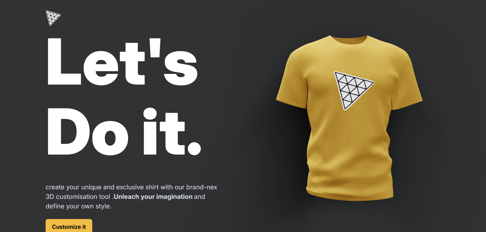

# 3D shirt designer

React + Vite frontend, Three.js shirt preview, and a separate Express backend. Customize the shirt color, upload artwork, or generate a design from a prompt.

## Free Hugging Face image generation

The default backend calls the public [FLUX.1 Schnell ZeroGPU Space](https://huggingface.co/spaces/black-forest-labs/FLUX.1-schnell) through Gradio. It does not use Hugging Face Inference Providers credits and never automatically falls back to a paid provider.

When the free Space is quota-blocked, cold, or down, the AI tab does not dead-end: the backend automatically falls back to the **Gemini image model** (`gemini-2.5-flash-image`, using the free `GEMINI_API_KEY` already in `serveur/.env`), and if that also fails it draws a deterministic **local pattern** with Node's built-in zlib (`services/fallbackArtwork.js`) — no API, no GPU, no dependencies. Fallback responses carry `"engine": "gemini-image"` or `"engine": "local"` next to `photo`/`mimeType`.

With `HF_TOKEN` blank, the backend attempts anonymous access to the public Space, as used for the included tiger sample. Access, queues, and free GPU quotas can vary. If you configure a token, all users of this backend share that account's quota. See [current quotas](https://huggingface.co/docs/hub/spaces-zerogpu). This setup is intended for a personal prototype, not an unrestricted public generation service.

### Setup

Use Node.js 22 or newer. Install dependencies in both directories:

```sh
# Project directory
npm install
cd serveur
npm install
```

Use `serveur/.env.example` as a reference. If `serveur/.env` already exists, update these entries while preserving other settings:

```dotenv
IMAGE_PROVIDER=huggingface
HF_TOKEN=
HF_SPACE_ID=black-forest-labs/FLUX.1-schnell
PORT=8080
```

`HF_TOKEN` is optional for anonymous access to this public Space. If Hugging Face requires sign-in, create a Read token in [Hugging Face Access Tokens](https://huggingface.co/settings/tokens). Put the token only in `serveur/.env`; never in chat, frontend code, or a `VITE_` variable. Revoke shared tokens and create a replacement. Environment files are ignored by Git; the example contains no secrets.

Start the backend from `serveur/` with `npm run dev`. In a second terminal, start the frontend from the project directory with `npm run dev`. Open the Vite URL, choose Customize, open the existing AI tab, describe the design and click AI Full. The original interface is preserved; AI Logo has been removed. Art direction is inferred from the prompt. Restart the backend after changing environment variables.

Full designs use the garment's native texture coordinates across the front, back and sleeves, preserving its fabric shading. Generated designs automatically hide the existing logo and coordinate collar/cuff trim with the image's dominant color. The existing color picker changes the trim while a full design is active. Image uploads and the original shirt filter buttons remain available.

The Space must expose `/infer` with inputs `prompt`, `seed`, `randomize_seed`, `width`, `height`, and `num_inference_steps`. `HF_SPACE_ID` may point to a compatible public clone; arbitrary Spaces can have different APIs. Images are requested at 1024 × 1024 with four steps. The full-shirt brief requests flat edge-to-edge textile artwork, coordinated colors, medium-scale motifs and matching edges, without mockups, folds, lighting or isolated logos. These are generation instructions; exact colors and seamless repeats are not guaranteed. Short descriptions of one or two sentences work best with the model's limited prompt length.

### Generation API

`POST /api/v1/dalle` accepts a JSON body:

| Field | Accepted value |
| --- | --- |
| `prompt` | Required nonempty string, up to 2000 characters. |
| `mode` | `full` by default. Explicit `logo` remains available for older clients and the sample script. |
| `style` | `sport` (default), `minimal`, `botanical`, or `abstract`. |
| `palette` | Optional array of 2–4 colors in `#RRGGBB` format. These guide the generated textile's colors. |
| `seed` | Optional integer from 0 to 2147483647. Omit to generate a new variation. The app derives this seed from the prompt itself, so the same description always produces the same design while a changed description produces a new one. |

For example:

```json
{
  "prompt": "Flowing angular bands with restrained gold accents",
  "mode": "full",
  "style": "sport",
  "palette": ["#102A43", "#A51C30", "#F4C95D"]
}
```

Successful Hugging Face responses contain `photo` (base64 image bytes), `mimeType`, and `seed` (the actual seed reported by the Space, or `null` if unavailable). Reuse that seed with the same prompt, style and palette to request the same design; reproducibility also depends on the Space's model and implementation staying unchanged. Invalid generation options return HTTP 400 before contacting the Space.

### Design assistant chat

The floating chat button opens an assistant that accepts **Darija (Arabic or Latin letters), English and French** and answers in the same language. Darija greetings such as `salam`, `slm`, `marhaba` or `سلام` get a Darija greeting back. It suggests colors, styles and full-shirt patterns; a suggestion ending with a `#design:` line can be sent to the AI designer with one tap.

`POST /api/v1/chat` accepts `{ "messages": [{ "role": "user", "content": "..." }] }` and returns `{ "reply": "...", "source": "ai" | "local" }`. The primary provider is the free, keyless Pollinations text API; when it is unreachable the built-in local assistant answers instead, so no credentials are required. Set `CHAT_PROVIDER_URL` in `serveur/.env` to use a compatible endpoint. The route rate-limits each IP to 20 messages per 5 minutes.

### Hosting and errors

Development uses `http://localhost:8080/api/v1/dalle`; production uses `/api/v1/dalle`. For a separate backend host, set the frontend build variable `VITE_API_URL` to its full generation endpoint. For the relative production URL, configure your host to proxy `/api` to Express.

Invalid supplied tokens, sign-in requirements from the Space, exhausted free quota, and unavailable Spaces produce actionable errors. A missing token does not block the request locally. The UI keeps the prompt on failure and times out after three minutes; the backend stops waiting after two and a half minutes. Cancellation is best effort: work already running on the Space may still consume GPU time.

Legacy `openai`, `gemini`, and `pollinations` branches require explicit `IMAGE_PROVIDER` selection; their availability and pricing are separate. OpenAI credentials are unnecessary for the Hugging Face integration. Keep `IMAGE_PROVIDER=huggingface` for the free Spaces workflow.

## Wear it — free live camera preview

Choose a garment, then click **Wear it** on the homepage or in the editor. Allow camera access and step back until your shoulders and hips are visible. Your selected color, uploaded artwork or generated fabric appears on the 3D garment. Size and Position adjust the approximate fit. Close the window to stop the camera; switching away from the tab pauses it.

Eight garments are available: T-shirt, Dress, Suit, Hoodie, Pants, Jacket, Cap and Backpack. The designer-only **Backpack** is hidden from the Wear it selector because the camera pose landmarks cannot place a bag on your back. Pants, the Dress and the Suit wait until your hips are in frame and fit your full body; the Cap tracks your face instead of your shoulders. Pants, Jacket and Cap are procedural models built in code (no download file) and are unisex.

This feature runs MediaPipe Pose Landmarker on the device in a worker. It needs no API key, generation backend, or paid credits. Its runtime and model are included locally under `public/tryon/`; use HTTPS when deployed, or localhost during development. The preview requests video only and does not upload or record camera frames. Runtime metrics requests are blocked inside the tracker. Model sources and licenses are in [the tracking asset notice](public/tryon/README.md).

This is a body-tracked 3D overlay, not photorealistic video generation or a clothing-size measurement. Garment sleeves do not bend independently with your arms, and your existing clothes are not removed. Face the camera and keep your arms relaxed. Full dress/suit previews need enough room for your body to be in frame. These limitations differ from [AnyWear's Decart-powered generative try-on](https://docs.platform.decart.ai/models/realtime/virtual-try-on), whose API has separate paid usage. No Decart integration or paid fallback is enabled.

The MediaPipe package is pinned. If intentionally upgrading it, run `npm run sync:tryon-assets`, update the asset notice and test initialization in supported browsers; JavaScript and WASM versions must match. `npm run test:tryon` checks fitting and camera-worker lifecycle without activating a webcam.

## Checks

```sh
# Project directory
npm run build
npm run lint

# serveur directory
npm test
```

Backend tests mock Space responses; they never generate images or spend credits. The project has existing frontend lint issues; see the historical [scan](PROJECT_SCAN.md).


# usa-thirduin
